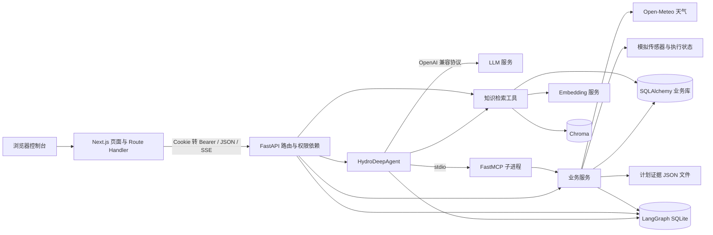
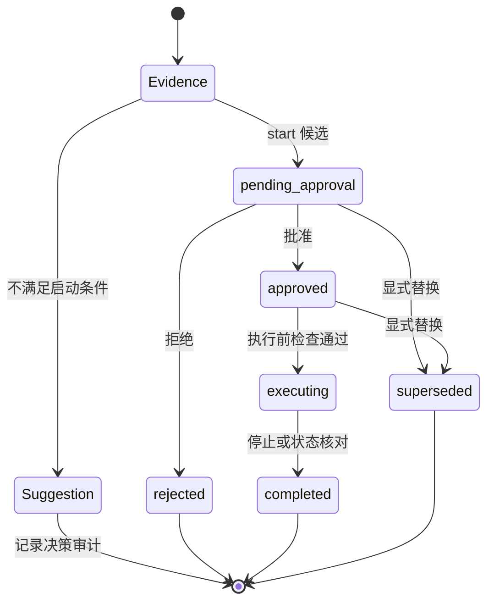
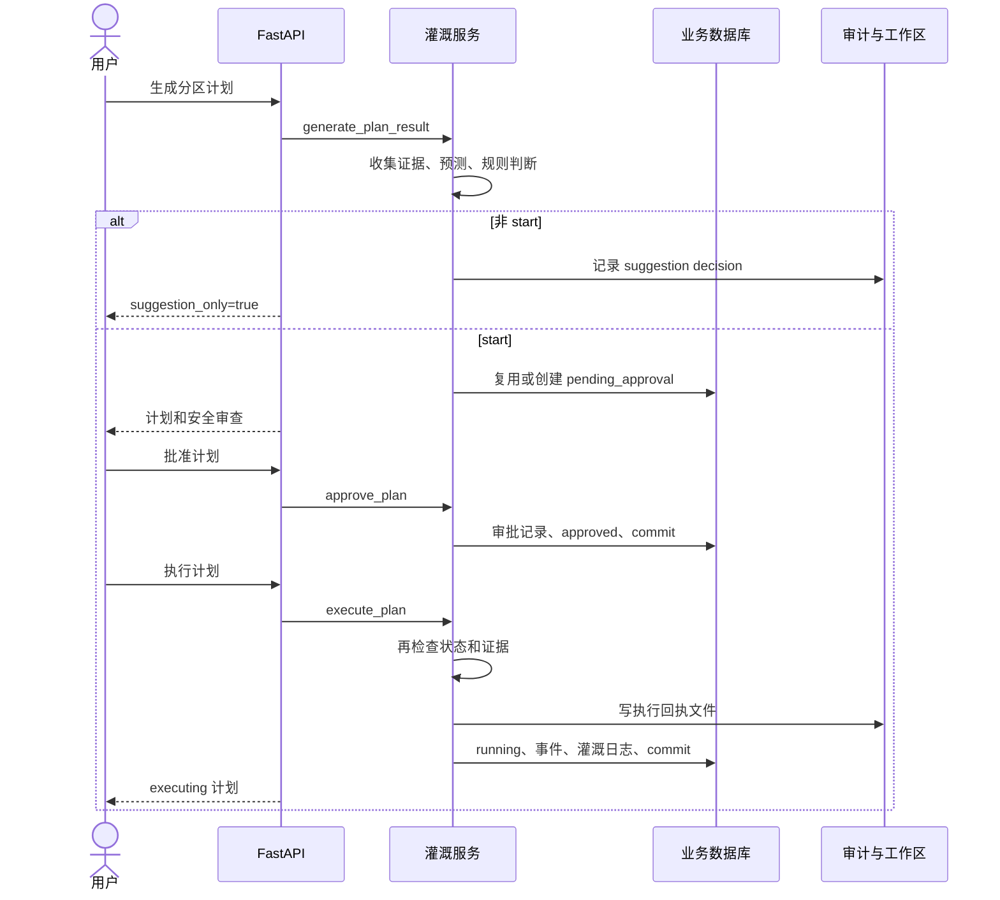
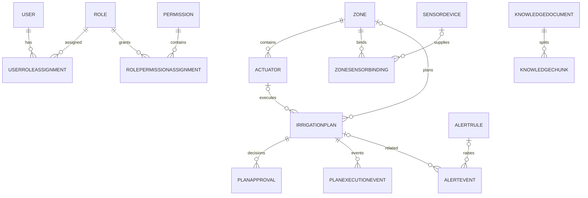
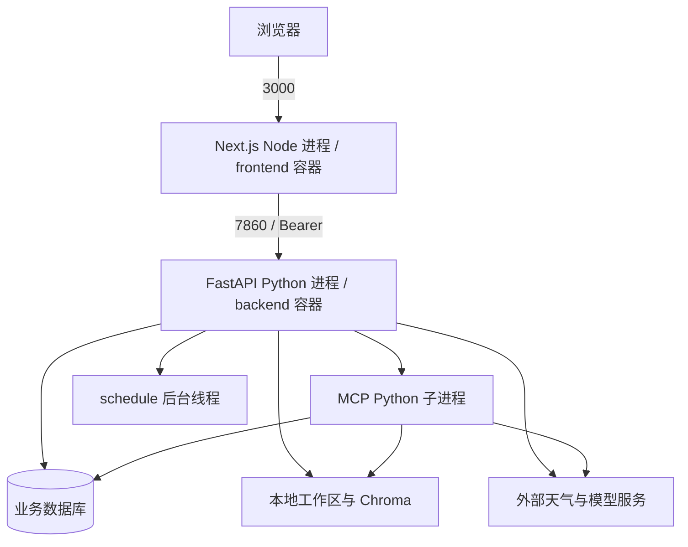

# HydroAgent 项目概要设计说明书

## 1. 设计基线与阅读方式

基线为 2026-11-19 的 `6afbde4` 加当前工作区改动，包括多模型配置适配。本文描述当前架构；需求与限制见[需求规格](项目需求规格说明书.md)，接口、字段和算法见[详细设计](项目详细设计说明书.md)。

架构主体是 Next.js 控制台、FastAPI 应用、Python 业务服务以及 LangChain/MCP 智能体。传统 `src/ui`、`src/llm/llm_agent.py`、`src/control` 等模块仍存在，不能把这些遗留兼容入口自动视为当前 Web 主调用链。

## 2. 总体架构

图中 MCP 到业务服务是进程内 Python 调用，不是再次请求带 HTTP 鉴权的 API。LLM 负责工具编排和回答，`irrigation_service` 负责规则及状态流转。自动检查直接调用业务服务生成计划，不依赖一次 LLM 推理批准动作。

### 2.1 子系统职责

| 子系统 | 主要职责 | 主要实现 |
| --- | --- | --- |
| 前端控制台 | 页面权限、数据读取、计划操作、图表、聊天事件渲染 | `frontend/src/app`、`components`、`lib` |
| HTTP 接口层 | 参数解析、权限检查、错误转换、审计、SSE 输出 | `src/api.py`、`src/routers` |
| 灌溉服务 | 证据聚合、规则、候选建议、计划审批执行、停止、去重 | `src/services/irrigation_service.py` |
| 预测与学习 | 短期湿度线性回归、历史计划决策树建议、显式回退 | `ml_prediction_service`、`decision_learning_service` |
| 管理服务 | 身份、RBAC、资产、告警、统计、报表与业务设置 | `src/services` |
| 智能体 | 模型初始化、模式和 Skill、工具代理、流式事件 | `src/llm` |
| MCP 工具 | 向 Agent 暴露观察、分析、计划与执行函数 | `src/mcp_server.py` |
| 知识服务 | 文本去重切分、向量化、检索、文档元数据 | `src/knowledge` |
| 配置与存储 | YAML/环境解析、ORM、会话检查点、向量文件 | `src/config`、`src/database`、`src/llm/persistence.py` |

### 2.2 前端组织

页面包含登录、总览、调度、可视化、聊天、资产、告警、历史、知识、用户、报表、设置。服务器组件使用 `requirePermission` 和 `fetchBackendJson`；浏览器交互通过同源 Route Handler 转发。`getSessionUser` 使用 React cache，后端 fetch 设置 `cache: no-store`。

浏览器登录得到用户资料，令牌保存在 `hydro_auth_token` HttpOnly Cookie。Next.js 取 Cookie 后向 FastAPI 发送 Bearer。聊天入口浏览器使用 `/api/chat/stream`，实际后端为 `/api/chat`；报表代理透传 CSV 和下载文件头。

ECharts 用于数据展示，TanStack Query、延迟图表组件和分区请求用于减少页面阻塞。并非每条历史服务器数据聚合路径都采用相同降级策略；不能将局部优化推广为全站统一性能保证。

## 3. 业务设计与状态模型

### 3.1 计划生成与决策分层

证据按分区组织：区配置、传感器平均值、天气摘要、当前计划、数据库策略、预测和历史学习建议。规则先检查传感器、天气和执行器，再判断湿度与降雨例外；决策树不能把阻断条件直接改成可执行。

有效预测可用 `min(当前湿度, 预测湿度)` 参与亏缺判断；降级预测只作为低置信度信息。时长可由置信度达到门槛的决策树建议覆盖。`start` 才创建正式计划；`hold` 返回审计建议。建议对象与计划对象是两个不同的产品概念。

执行前检查失败时保留 approved 状态并报错；运行中重复执行返回原计划。图中的终态表示本轮计划不能再执行，不代表已删除数据。`draft`、`ready`、`cancelled` 等字段值还用于默认、历史或兼容处理，不能据此推断存在完整公开操作接口。

### 3.2 审批执行时序

HTTP API 额外记录后台审计，并在有关联会话时记录计划事件。SQL 提交、检查点写入、文件写入不是一个跨存储原子事务。手动覆盖把上述创建、批准、执行串联到一次请求，但内部仍多次 commit。

### 3.3 自动化与停止

启动时读取数据库采集间隔，创建 `schedule` 后台线程；循环触发 `auto_check`，遍历启用分区，生成建议或待批准计划。活跃计划和 60 分钟内相同证据抑制重复生成。当前配置更新未重新注册这个定时任务，变更间隔后需重启才能保证调度更新。

`reconcile_running_irrigation` 根据运行时长和有效湿度停止，`summarize_system_irrigation` 会调用它。因此部分查询实际具有写副作用。没有独立硬件定时器或持久化分布式调度保证，多 worker 启动还可能各自创建调度线程。

## 4. 数据架构

### 4.1 存储分工

| 存储 | 内容 | 位置与重要限制 |
| --- | --- | --- |
| SQLAlchemy 业务库 | 21 个业务实体表，包括资产、计划、审批、审计和知识元数据 | 默认仓库根 `irrigation_db.db`；DB_NAME 可改名 |
| LangGraph SQLite | 会话元数据、消息回合、工具轨迹、决策、计划事件、工作记忆 | `.hydro_workspace/langgraph-persistence.sqlite` |
| Chroma | 知识片段文本、元数据和向量 | `.hydro_workspace/knowledge/chroma`，集合 `hydro_knowledge_base`，cosine |
| 计划工作区 | 输入证据、安全审查、计划与执行回执等 JSON | `.hydro_workspace/<plan_id>/` |
| YAML / Skill 文件 | 模型配置与可加载技能资源 | 根配置文件、`skills/` |

图只显示核心 ORM 关系，不表示所有业务 ID 都是数据库外键。例如 IrrigationLog 中 zone_id、plan_id 是索引字符串；SensorData.sensor_id 也不是传感器资产外键。ORM 关系与声明的 ondelete 不代表所有 SQLite 连接均已启用外键强制约束。

### 4.2 一致性和迁移

`init_db` 调用 create_all，SQLite 额外补齐少数字段，并直接删除废弃的四张聊天/审计表。该过程没有通用版本化迁移框架，也不是将旧聊天数据迁移进 LangGraph。备份旧库后再考虑真实升级。

知识库 SQL 元数据和 Chroma 使用补偿删除处理部分失败，无法提供两阶段提交。切换向量模型可能改变维数或空间；不自动迁移集合。主业务库换成 PostgreSQL/MySQL 后，会话和向量仍是本地文件存储。

## 5. 智能体、工具和外部依赖

`HydroDeepAgent` 初始化同一聊天模型供主 Agent 和参数解析代理使用。MCP 通过当前 Python 解释器运行 `src/mcp_server.py`，调用 stdio 工具。服务端按模式和 Skill 选工具，再通过 LangChain create_agent 编译；编译缓存键包含模式和活动 Skill ID。

Skill 定义带工具白名单、触发提示、阶段映射及指令片段，不能越过模式白名单。六个阶段为 evidence、analysis、planning、approval、execution、audit。当前提示词、mode 白名单和 HTTP 角色权限不是一套自动统一的授权策略，差异详见需求 GAP-02、GAP-05。

模型配置由 `Config` 解析，兼容旧 OPENAI_* 运行属性。OpenAI 可选 Responses 或 Chat Completions，MiniMax 默认 Chat Completions；Ollama Embedding 使用原生接口。具体选择、密钥和回退规则见[多模型配置](model-provider-configuration.md)。顶层 proxy 是天气专用配置，不是全局模型代理。

## 6. 安全与故障设计

- 身份：数据库用户密码使用随机盐 PBKDF2；应用令牌为自定义两段 HMAC 签名数据，不能描述为标准 JWT/OAuth。默认有效期 8 小时。
- 权限：API 通过 require_permission 查询数据库权限；复合接口有多项检查。会话与 MCP 工具身份传递尚未达到逐用户资源隔离。
- 审计：后台操作写 AuditEvent；计划领域写审批与执行事件；Agent 轨迹写 LangGraph 通道。业务 actor 与登录用户名需分别理解。
- 故障：天气失败标记 stale/unavailable 并阻断；预测不足返回 fallback；运营聚合支持部分结果；SSE 流内返回 error/done。
- 健康：`/api/health` 固定返回应用状态，不探测数据库、LLM、Ollama、Chroma 或天气。`/api/status` 可报告 Agent 是否初始化，但也不是全部外部依赖就绪检查。
- 配置：密钥状态返回掩码；YAML 实际仍存明文。模型配置写入与 Agent 重载不是原子操作，重载失败保留配置并返回错误信息。

缺口优先级供维护者参考：先统一工具授权与用户所有权，再处理执行事务及并发互斥，然后完善设备通信、迁移、备份与健康检查。本次只记录，不修改代码。

## 7. 部署、运维和性能边界

默认脚本前端 3000、后端 7860；Compose 前端内部地址为 `http://backend:7860`。后端镜像 Python 3.12，前端镜像 Node 22。实际依赖版本由 requirements 下限及前端锁文件约束，不能把下限当作所有环境实际版本。

当前部署事实：

1. Compose 只挂载 logs 与 config.yaml，没有业务 SQLite、`.hydro_workspace` 和 skills 的持久化挂载；重建容器有数据丢失风险。
2. 后端 Dockerfile 仅复制 src，没有复制本地 skills、AGENTS.md；容器技能目录与本地运行不能假定完全一致。
3. Dockerfile 构建依赖固定内网代理，迁移到其他网络可能无法构建；运行期 YAML proxy 不控制镜像构建。
4. Compose 默认 DEMO_MODE=true；空用户库初始化单个随机密码 admin 并写启动日志。非演示模式初始化内置账号；已有用户时不重新播种。
5. config.yaml 是单文件挂载，但配置保存用同目录临时文件加 os.replace；容器挂载点上原子替换的可用性需单独验证，不能据本地保存成功推断容器也成功。
6. SQLite 使用 NullPool 和 check_same_thread=false；缓存、模拟湿度、调度和 Agent 单例均为进程级状态，不提供多实例一致性保证。

性能设计是减少等待，而非已证明的高并发架构：传感器缓存 5 秒，天气成功缓存 600 秒、失败重试窗口 5 秒，同城市并发天气 Future 合并；分区调度和大屏避开不必要天气依赖。历史优化数据见[优化结果](performance-optimization-results.md)，本轮未重测页面或真实网络延迟。

## 8. 维护策略与扩展接点

新增业务行为应先落在服务层，再接 HTTP 和 MCP；同时核对两条入口的权限与审计。新增模型服务优先复用配置分组与现有兼容协议；非兼容协议需增加明确的客户端适配，不应仅修改 URL。

真实传感器接入需要替换模拟采集、定义时间戳/新鲜度、处理缺失绑定；真实执行器接入需要命令回执、状态查询、超时停止与一致性策略。当前“running”只是应用状态，不能承担这些职责。

文档更新顺序：变更需求编号和限制 → 更新概要职责/关系图 → 更新详细接口与状态表 → 对照测试 → 更新索引验证记录。接口与 ORM 清单来自静态源码解析，变更后需要重新核对。
