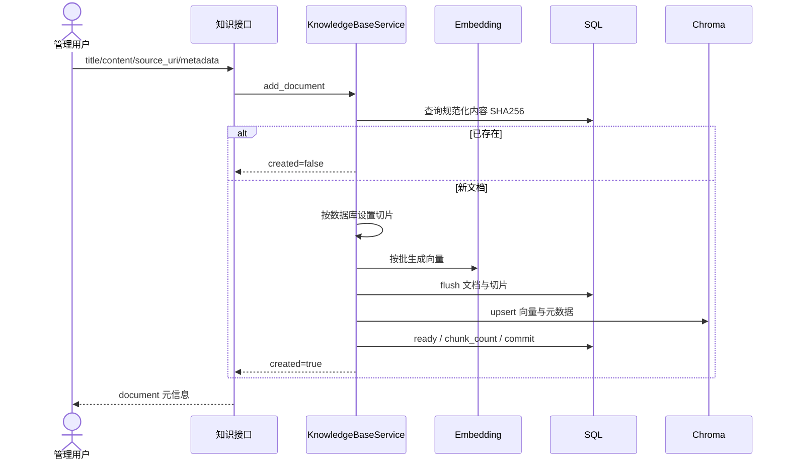

# HydroAgent 项目详细设计说明书

## 1. 基线与实现导航

分析日期 2026-11-19，基准提交 `6afbde4`，包含当前未提交的多模型适配。本文供研发定位调用链、接口、持久化和异常边界。配套[需求规格](项目需求规格说明书.md)、[概要设计](项目概要设计说明书.md)及[验证记录](README.md)。

核心导航：HTTP 入口 [api.py](../src/api.py)、业务状态机 [irrigation_service.py](../src/services/irrigation_service.py)、ORM [models.py](../src/database/models.py)、Agent [langchain_agent.py](../src/llm/langchain_agent.py)、MCP [mcp_server.py](../src/mcp_server.py)。附录 A—E 的清单通过 Python AST 和前端文本静态提取，未通过启动生产应用生成。

## 2. 接口契约

### 2.1 通用约定

FastAPI 在 main.py 为所有业务 router 添加 `/api` 前缀；子 router 另有 `/auth`、`/assets` 等前缀。Swagger 与 ReDoc 位于 `/api/docs`、`/api/redoc`。OpenAPI 元信息为 4.0.0，但 status/visualization 返回 5.0.0；文档以提交与工作区为版本依据。

认证使用 `Authorization: Bearer <token>`，权限缺失返回 403，无效身份返回 401。Pydantic 参数校验通常返回 422；业务 ValueError 在相应端点转换为 400；资源读取常用 404；天气和聚合不可用用 503；外部模型列表连接失败用 502。没有全局统一的 success/data 包装，各端点返回不同对象，见附录 A 的顶层字段。

部分 GET 有写副作用：传感器查询可新增采样记录，状态查询可核对并停止运行计划，告警查询会评估并写告警，ensure 系列可能补初始化数据。因此不能仅按 HTTP 方法推断纯读。

### 2.2 计划接口

| 操作 | 输入 | 响应与边界 |
| --- | --- | --- |
| POST `/api/plans/generate` | zone_id 必填；conversation_id 可空；trigger=manual；replace=false | `{plan,suggestion,reused_existing,suggestion_only}`；两类结果明确互斥 |
| GET `/api/plans` | limit=20，active_only=false；无 zone_id 过滤参数 | `{plans:[...]}`；活跃计划独立查询，不从最近历史列表再过滤 |
| GET `/api/plans/{plan_id}` | 路径 ID | `{plan:...}`，未知为 404 |
| POST `/api/plans/{plan_id}/approve` | actor=user，comment 可空 | `{plan:...}`，只从 pending_approval 进入 approved；已 approved 返回原记录 |
| POST `/api/plans/{plan_id}/reject` | actor=user，comment 可空 | `{plan:...}`，只从 pending_approval 进入 rejected；已 rejected 返回原记录 |
| POST `/api/plans/{plan_id}/execute` | actor=user | `{plan:...}`，先状态校验再收集证据；invalid 为 400；已 executing 返回原记录 |
| POST `/api/irrigation/control` | action，duration_minutes=30，zone_id 可空 | start 为手动覆盖；stop 可按区或全部停止；HTTP 权限为 plans:execute |

API 审计用 current_user.username，领域审批/执行 actor 使用请求参数；不要将请求体 actor 当成服务端身份断言。计划生成 requested_by 为 api，而审计仍写真实登录用户名。

计划结果示例仅展示关键字段，不表示完整响应：

```json
{
  "plan": null,
  "suggestion": {
    "suggestion_id": "suggestion_example",
    "zone_id": "zone_example",
    "proposed_action": "hold",
    "risk_level": "medium",
    "recommended_duration_minutes": 30,
    "reasoning_summary": "近期降雨，暂缓灌溉",
    "evidence_summary": {},
    "safety_review": {"can_execute": false, "approval_required": false}
  },
  "reused_existing": false,
  "suggestion_only": true
}
```

hold 的 recommended_duration 可能保留亏缺计算结果，不代表可执行时长。前端应以 proposed_action、suggestion_only 和安全条件决定操作按钮。

### 2.3 对话和 SSE

先 POST `/api/conversations` 创建会话，再 POST `/api/chat`，请求包含 conversation_id、message、可选 mode 和 skill_ids。浏览器访问 Next.js `/api/chat/stream`，由代理转发到后端；不使用 GET EventSource 创建对话。

返回 `text/event-stream`，每条消息为 `data: <JSON>` 加两个换行。HTTP 建连成功后仍可能出现流内业务错误。

| type | 主要语义 | 关键内容 |
| --- | --- | --- |
| text | 文本增量 | content，可能携带 Agent/Skill 上下文 |
| tool_call | 工具调用开始 | tool、args、normalized_args、run_id、阶段/Agent 信息；API 保存 trace |
| tool_result | 工具返回 | tool、output、耗时及关联信息 |
| plan_proposed / plan_updated | 新建或复用/读取计划 | plan |
| suggestion_result | 非 start 审计建议 | suggestion |
| approval_requested | control 工具要求批准 | tool、details |
| approval_result | 批准或拒绝结果 | plan、decision |
| execution_result | 执行已批准计划结果 | plan |
| error | Agent、代理或持久化等处理异常 | content |
| done | 回合结束 | 可携带 working_memory、inferred_mode、active_skills |

工具输出只有包含有效 plan_id/suggestion_id 才转换为对应业务事件，不能依据自然语言回答推断执行成功。API 用 trace_id、conversation_id、plan_id 等串联记录；更新工作记忆中的活动分区、最新计划、待审批计划、已批准计划与风险摘要。

当前会话入口只检查 chat:view 和 thread_exists，没有 ownership 条件。mode 支持显式指定，非法值走文本推断。Agent 模式与登录用户的角色权限未做统一裁剪，见需求 GAP-02。

### 2.4 设置、知识和聚合接口

- GET `/api/settings` 同时返回兼容字段、yaml_settings 和 business_settings；敏感值只有 configured/masked_value。
- PUT `/api/settings` 先写模型 YAML，再写数据库业务设置，随后重载 Agent 并写审计；响应含 success、settings、agent_reloaded、agent_reload_error。重载失败不回滚配置，跨 YAML/SQL 也无统一事务。
- GET `/api/settings/openai-models?target=chat|embedding` 使用已保存地址与密钥。Ollama 列表走 `/api/tags`，其他兼容服务走 `/models`；第三方服务未必支持枚举。
- 知识创建接收 JSON 文本 title/content/source_uri/metadata，不包含 PDF/Office 二进制解析接口。source_uri 为来源元数据，不会自动下载该 URL。
- 文档列表 page≥1、page_size≤50；切片详情 chunk_page_size≤20；搜索 limit 为 1..10。HTTP 搜索默认 limit=4，Agent 工具默认 top_k=4；只有直接服务调用未传 limit 时才使用数据库默认。
- `/api/operations?section=all|zones|plans` 支持 errors 形式的部分失败；`/api/visualization?section=summary|models` 分离摘要和模型证据。权限组合以附录 A 为准。

## 3. 灌溉服务设计

### 3.1 证据收集

`collect_zone_evidence` 聚合 ZoneEvidence；传感器缓存按 zone_id 保存 5 秒，天气按 location 保存有效结果 600 秒，失败结果 5 秒。天气在途请求由锁和 Future 合并；缓存为进程内数据，HTTP 与 MCP 子进程不共享。

传感器优先取启用的分区绑定，无绑定时取一个启用的 SensorDevice，再回退 config.SENSOR_IDS 或 sensor_001。每个读数四个指标须为非布尔的有限数值，湿度范围 0..100；无效读数丢弃，剩余有效值求均值，全部无效为 missing。有效读取可能写 SensorData 并更新资产 last_seen。

当前 DataCollectionModule 用模块级湿度状态模拟蒸发，初值 90、最低 10，每秒下降 0.0014；其他环境指标为固定示例值。运行中的模拟读数还会被稳定化函数调整，用于演示停止逻辑。不可将其描述为跨设备独立物理测量。

天气读取城市预报，校验前几条 dayweather 非空、不是未知；前两条 day_weather 含“雨”即 rain_expected=true。失败保留旧 forecast_days 但 status=stale，rain_expected=None；无旧结果为 unavailable。服务层执行要求 status=ok，旧预报展示不构成执行许可。

### 3.2 规则算法

设当前湿度 `m`、有效预测 `p`、分区阈值 `t`、默认时长 `d`：

```text
decision_moisture = min(m, p)  # 仅非 fallback 且预测有效时
否则 decision_moisture = m
emergency = max(0, t - 15)
deficit = max(0, t - decision_moisture)
duration = max(d, int(deficit * 1.5) + 10) if deficit > 0 else 0
start = decision_moisture < t
        且无阻断因素
        且(不预期降雨 或 m < emergency)
```

阻断因素：传感器非 ok、天气 stale/unavailable、缺执行器、执行器禁用、正在运行或状态不在 idle/ready/stopped。分区禁用在执行阶段明确拒绝；不能仅从 `_build_plan_payload` 推断所有调用者在生成阶段都校验了启用状态。

风险有 blockers 为 high，否则降雨等风险为 medium，默认 low。低置信度预测和决策树回退写入 risk_factors，但并非每个 risk_factor 都提升 risk_level。紧急程度根据 decision_moisture 相对阈值和紧急带判断。

若 start 且有效决策模型时长存在、置信度≥0.6，用 max(1, model_duration) 覆盖初始 duration；模型动作 hold/defer 写入风险说明，不直接覆盖规则裁决。所有 start 都 requires_approval=true。

证据 JSON 包含 zone、sensor_summary、weather_summary、system_settings、ml_prediction、decision_model、current_plan、evidence_hash。安全审查包含 blockers、risk_factors、can_execute、approval_required。`can_execute` 表示候选安全条件，不代表已经批准。

### 3.3 创建、复用与去重

`generate_plan_result` 先计算新候选。非 start 构造 suggestion 并记录 decision，返回 suggestion_only；start 查找打开计划，默认复用，replace 时禁止替换 executing，其余旧计划标 superseded 并提交后创建新计划。

`_persist_plan` 创建正式计划、生成工作区并提交，再记录决策。`create_plan` 是较底层入口，仅允许 start，不提供与 generate_plan_result 完全相同的复用语义。

自动入口 `create_auto_plan_if_needed` 对非 start 记录建议；对 start 先检查活跃计划，再比较最新计划 evidence_hash 与 60 分钟窗口。去重依赖代码查询，不是数据库唯一约束；并发两个请求均通过检查的情况尚未有锁保证。

### 3.4 状态字段

| 主 status | approval_status | execution_status | 进入方式 |
| --- | --- | --- | --- |
| pending_approval | pending | not_started | start 正式计划创建 |
| approved | approved | not_started | 批准 |
| rejected | rejected | 通常 not_started | 拒绝 |
| executing | approved | running | 执行检查通过 |
| completed | 通常 approved | stopped 或 completed | 停止/结束 |
| superseded | not_required | 通常 not_started | 显式替换旧计划 |

`_sync_plan_status_fields` 负责兼容字段同步。draft 是 ORM 默认，ready 用于非 start 候选及历史数据，cancelled 为兼容状态；当前没有与所有状态一一对应的公开端点。

### 3.5 执行、停止与事务边界

`execute_plan` 要求 proposed_action=start，status=approved 且 approval_status=approved，执行器启用且状态可执行，分区启用；重新收集证据，传感器和天气须 ok，降雨时当前湿度必须低于紧急带。之后改执行器 running，记录 executed_at、execution_result、PlanExecutionEvent、IrrigationLog 和 JSON 回执并提交。

当前没有驱动阀门的网络或串口调用。已 executing 直接返回现状；完成后因状态不符拒绝执行。并发两次执行、请求取消或文件写入后 SQL 失败的原子性未证明。

停止会结束运行日志、归并计划终态并写 stop 事件。时长到期优先停止；湿度停止需超过保护时间并且有效平均湿度达到阈值。保护时间默认 60 秒，短计划取更短的计划秒数。状态核对由调用触发，不是硬实时设备 watchdog。

手动 start 覆盖候选动作为 start，指定时长，依次持久化、批准、执行；内部提交多次，执行安全校验失败仍可能留下已批准记录。工作区文件、SQL 审计、LangGraph 记录也不在同一事务内。

## 4. 预测、统计与告警

### 4.1 湿度预测

`predict_zone_soil_moisture` 默认读取 168 小时历史，至少 6 条样本，特征使用时间索引、当前湿度、温度、光照、降雨和天气指标；训练目标为下一条已存读数的湿度。用 LinearRegression 滚动预测，默认 24 小时，点数限制 1..72，预测值限定 0..100。

置信度由训练样本数分档，24 对及以上为 high，其余可训练样本为 medium；这不是校准概率或误差评估。历史采样不等距时，单步训练与逐小时输出之间存在解释边界，未进行农艺精度验证。

### 4.2 历史计划学习

`recommend_plan_decision` 默认读取最近 200 个计划样本，至少 6 条；使用 12 个特征，包括分区编码、湿度、阈值、亏缺、预测、雨况、传感器/执行器状态、默认时长、风险和执行编码。分类器与回归器均 max_depth=4、min_samples_leaf=2、random_state=42。

训练标签是历史计划 proposed_action 与 recommended_duration，不是真实作物收益或灌溉效果；“历史学习”不代表在线强化学习。样本不足或模型依赖不可用时返回 fallback_used、reason 等解释字段。

### 4.3 告警、统计和导出

告警规则默认 low_moisture、sensor_offline、actuator_fault、weather_risk。查询告警调用 evaluate_alerts 并更新未关闭事件；处理操作进入 acknowledged/resolved。MCP 的 manage_alarm 使用子进程 `_alarm_state`，不等同数据库 AlertRule 或 SystemSettings 的统一配置修改。

analytics_service 按范围聚合湿度、计划漏斗、告警趋势；report_service 输出运营、审计和分区 CSV。已停止的计划仍属于已执行统计口径。统计来自软件数据，不是流量计量或已验证的真实节水指标。

## 5. 智能体、Skill 与持久化

初始化顺序为检查点服务 → HydroChatOpenAI → MCP 工具发现 → 参数归一化代理 → 自定义知识检索工具。聊天调用 build_system_prompt，加入模式、Skill 指令和工作记忆上下文；使用 thread_id 恢复检查点。

参数解析先使用实际分区与计划目录做本地别名匹配，必要时使用同一 LLM 做结构化解析，避免直接把“一区”等文本作为 canonical ID。模式工具白名单限定能力，但当前用户的数据库权限没有沿这条链路做完整逐工具授权。

Responses 模式将出站 system 指令改为 developer，并使用流式请求；Chat Completions 保留 system 与 reasoning_content。对应传输兼容测试见 test_responses_gateway。

Skill 从本地目录和系统包装定义生成目录，支持 HTTPS 指定域名导入、UTF-8、200000 字节上限、10 秒超时；导入需要元数据。默认允许 raw.githubusercontent.com 与 gist.githubusercontent.com，来源和安装信息对外返回。Skill 是提示词/工具选择资源，不是任意代码插件执行器。导入网络安全边界应以校验实现为准，不宣称已完成全面 SSRF 安全审计。

持久化文件 `.hydro_workspace/langgraph-persistence.sqlite` 同时使用 SqliteSaver 和 AsyncSqliteSaver；六个业务通道为：

| 通道 | 保存内容 |
| --- | --- |
| hydro.thread.meta | 会话标题与元数据 |
| hydro.chat.turn | 对话回合 |
| hydro.trace.event | 工具调用与返回轨迹 |
| hydro.decision | 决策与建议审计 |
| hydro.plan.event | 对话中的计划事件 |
| hydro.working.memory | 结构化工作记忆 |

无会话决策可记录到 `__hydro_audit__` 审计线程。列表和详情从检查点历史归并，不是从旧 chatmessage 等表读取；默认历史扫描有条数限制，不能承诺无限量全历史导出。未定义用户所有权列。

## 6. 知识库详细流程



切片 size 至少 300，overlap 限制到 0..size/2，优先在后半区段落分隔处切分。文档规范化后计算 SHA256，当前去重查询没有数据库 checksum 唯一约束。向量按 32 条一批；Ollama 请求根地址 `/api/embed`，带 model/input/truncate=false，默认无 Key，超时 120 秒；OpenAI 使用 SDK `/embeddings`。

集合 cosine 距离转换成展示分数；不是模型置信度。查询最多 10 个片段，空集合不调用向量服务。SQL 管理全文与切片，Chroma 管理检索向量和来源信息。

写入失败回滚 SQL，并尝试删除已登记 chunk IDs 的向量；补偿失败被忽略。删除先删向量再删 SQL，SQL 后续失败可能造成元数据与向量不一致。没有自动重建 API；更换模型或维数后须另行安排重建，不能直接混用旧集合。上游 httpx/OpenAI 异常不全属于 KnowledgeBaseError，部分会成为未统一封装的错误。

## 7. 身份、权限和数据保护

密码使用 16 字节随机盐、100000 轮 PBKDF2-HMAC-SHA256；令牌为 base64url JSON 加 HMAC-SHA256，默认 TTL=28800 秒。`HYDROAUTH_SECRET` 控制签名密钥，`HYDROAUTH_TTL_SECONDS` 控制有效期。前端 Cookie 默认 8 小时，独立于后端 TTL 配置；HTTPS 或 AUTH_COOKIE_SECURE 决定 Secure 标志。

登录后校验数据库用户存在与启用状态，按数据库角色计算权限；退出写审计并清 Cookie，不撤销已发令牌。`security.authenticate` 的旧示例账号函数不是当前 auth_service 登录入口，不能作为现行账号规则。

具体 HTTP 权限见附录 A。特别注意：operations 同时要求 operations:view、assets:view、dashboard:view；visualization 在 dashboard:view 基础上按 section 检查 assets:view 或 operations:view，日志字段另按 history:view 控制。

当前没有会话所有权过滤、MCP 用户权限上下文、数据库行级租户边界或全局令牌撤销。客户端传入 actor 与登录用户名使用不同字段；权限与审计改进项见需求第 6 节。

### 7.1 默认角色权限矩阵

来自 ROLE_MATRIX，数据库中实际角色分配可变化；角色播种会补齐预期权限。这里只表示 HTTP 权限定义，不把它套用于 Agent mode。

| 权限 | admin | manager | operator | viewer | auditor |
| --- | --- | --- | --- | --- | --- |
| `dashboard:view` | 有 | 有 | 有 | 有 | 无 |
| `chat:view` | 有 | 有 | 有 | 有 | 无 |
| `history:view` | 有 | 有 | 有 | 有 | 有 |
| `knowledge:view` | 有 | 有 | 有 | 有 | 无 |
| `knowledge:manage` | 有 | 有 | 无 | 无 | 无 |
| `settings:view` | 有 | 有 | 无 | 无 | 无 |
| `settings:manage` | 有 | 无 | 无 | 无 | 无 |
| `users:view` | 有 | 无 | 无 | 无 | 无 |
| `users:manage` | 有 | 无 | 无 | 无 | 无 |
| `assets:view` | 有 | 有 | 有 | 有 | 无 |
| `assets:manage` | 有 | 有 | 无 | 无 | 无 |
| `alerts:view` | 有 | 有 | 有 | 无 | 无 |
| `alerts:manage` | 有 | 有 | 有 | 无 | 无 |
| `reports:view` | 有 | 有 | 无 | 有 | 有 |
| `reports:export` | 有 | 有 | 无 | 无 | 有 |
| `operations:view` | 有 | 有 | 有 | 无 | 无 |
| `plans:create` | 有 | 有 | 有 | 无 | 无 |
| `plans:approve` | 有 | 有 | 无 | 无 | 无 |
| `plans:execute` | 有 | 有 | 有 | 无 | 无 |

## 8. 配置与部署细节

### 8.1 配置来源

| 配置类别 | 来源和优先级 | 更新语义 |
| --- | --- | --- |
| 数据库、应用地址、日志等 | 对应环境变量优先于 YAML，具体字段按 Config | 多数需重启 |
| 聊天模型、地址、协议 | 新 llm_model 分组存在则用分组，否则旧平铺；可指定 provider，否则选首个模型名称非空分组 | API 写活动分组并重载 Agent |
| Embedding | embedding_model 独立选择；支持 ollam 别名 | 下次调用读取新配置，但旧向量不重建 |
| 密钥 | 对应外部环境覆盖 YAML；加载器自行同步的环境值不当成新的外部覆盖 | API 仅展示掩码；环境覆盖存在时保存 YAML 不等于改变有效密钥 |
| 策略、采集、知识切片与召回 | SystemSettings 数据库为运行期源；首次创建使用历史 YAML 回填 | API 更新数据库；已创建 Zone 有自己的阈值/时长 |
| 天气代理 | YAML 顶层 proxy | 仅特定 Open-Meteo 预报请求；非全局代理 |

分区阈值解析使用 `zone.soil_moisture_threshold or 数据库默认 or 40`，因此 0 被视为未配置。Config 历史默认阈值是 30；SystemSettings/Zone 列默认 40。文档不能给出忽略初始化路径的单一默认值。

`_write_yaml` 用同目录临时文件 + os.replace；设置候选先复制并校验再写盘。保留未活动 provider 配置，旧设置字段 openai_* 映射当前聊天服务商。业务设置更新未统一限制所有数字范围，部分消费端另行截断。

### 8.2 启动、检查与持久化

开发启动命令：

```bash
./start.sh
# 或分别启动
./start-backend.sh
./start-frontend.sh
# 仅检查 HTTP 应用可达性
curl --fail http://127.0.0.1:7860/api/health
```

启动依次建表、补 SQLite 字段、清旧会话表、初始化业务设置/分区/传感器/身份/告警、初始化检查点、异步预热 Agent、启动调度。异常通常记录日志继续，因此启动日志的“服务已启动”不能代替依赖检查。

业务库默认根目录 irrigation_db.db，工作区包含会话 SQLite、Chroma 与 plan_id 子目录；另需保存 skills 与私有 config。Compose 挂载不足、Dockerfile 只复制 src、固定构建代理和 config 单文件替换限制见概要第 7 节。SQLite 启动清理不迁移旧会话数据，实际升级前须另行备份与验证。

查询型健康检查与有副作用的状态接口要区分。故障定位按浏览器 Route Handler → FastAPI HTTP 状态/Server-Timing → 服务日志 → SQL/工作区 → 外部依赖逐层排查。不要把空列表、fallback 或 agent_initialized=false 解释为完全可用。

## 9. 异常、并发与遗留模块

| 场景 | 当前处理 | 维护限制 |
| --- | --- | --- |
| 数据采集全部失败 | missing、安全阻断 | 无绑定可能回退模拟源；需区分绑定缺失与采集失败 |
| 天气失败 | stale/unavailable、短期重试 | 旧日期仍可显示，不可据此启动 |
| 模型历史不足 | fallback_used | 没有准确率承诺 |
| Agent 初始化或流中异常 | error/done，记录日志 | HTTP 200 流不代表业务成功 |
| YAML 已保存但重载失败 | 返回 agent_reload_error | 磁盘配置与活动 Agent 可能暂时不一致 |
| 向量与 SQL 写入中断 | SQL 回滚和尽力补偿向量 | 非原子；删除与重建无统一事务 |
| 重复执行或替换 | 状态检查与复用 | 无行锁/唯一活跃约束，未验证并发单次执行 |
| 调度进程重启 | 启动时重新注册线程任务 | 无持久任务队列、多 worker 去重或独立设备定时停止保证 |

遗留 `ControlExecutionModule` 用实例内设备状态模拟 start/stop；LLMAgentModule 和 src/ui 保留旧封装；其控制、阈值和错误处理不等同当前分区计划服务。`src/ml/ml_model.py` 与当前服务层回归预测也不能混为同一个模型管线。新增功能应沿实际 FastAPI → 服务 / Agent → MCP → 服务路径核对。

## 10. 需求设计实现与测试追踪

表中测试为已有源码证据，不代表全部本轮执行。具体验证记录见文档索引。

| 需求编号 | 设计位置 | 实现证据 | 测试证据与覆盖边界 |
| --- | --- | --- | --- |
| FR-AUTH-001、FR-AUTH-002 | 第 7 节 | auth_service、security、user_router | [test_api_plans](../tests/test_api_plans.py) 登录/用户端点；[test_security](../tests/test_security.py) 密码和令牌；不证明工具授权 |
| FR-ASSET-001、FR-ASSET-002 | 第 2 节、附录 A/D | asset_service、asset_router | [test_api_plans](../tests/test_api_plans.py) 资产和分析端点；非硬件测试 |
| FR-DATA-001 | 3.1 | `_collect_zone_sensor_summary`、DataCollectionModule | [test_data_collection](../tests/test_data_collection.py)、[test_console_performance](../tests/test_console_performance.py) 数据与缓存边界 |
| FR-WEATHER-001 | 3.1 | `_get_weather_summary`、DataProcessingModule | [test_console_performance](../tests/test_console_performance.py) 过期/不可用/并发合并；[test_weather_api](../tests/test_weather_api.py) 代理与归一化 |
| FR-ML-001、FR-ML-002 | 第 4 节 | ml_prediction_service、decision_learning_service | [test_ml_prediction_service](../tests/test_ml_prediction_service.py)、[test_decision_learning_service](../tests/test_decision_learning_service.py)，不代表预测精度验收 |
| FR-PLAN-001、FR-PLAN-002 | 3.2—3.3 | generate_plan_result、_persist_plan | [test_zone_planning](../tests/test_zone_planning.py) `test_rain_risk_returns_suggestion_instead_of_formal_plan`、复用与替换测试 |
| FR-PLAN-003、FR-PLAN-004 | 3.4—3.5 | approve_plan、reject_plan、execute_plan | [test_zone_planning](../tests/test_zone_planning.py) 生命周期；[test_console_performance](../tests/test_console_performance.py) 安全证据；reject 测试名含 blocks_execution，但该用例只断言拒绝状态，不能据名称宣称执行反例已覆盖 |
| FR-PLAN-005、FR-PLAN-006 | 3.5 | manual_override_control、reconcile_running_irrigation | [test_zone_planning](../tests/test_zone_planning.py) 多区停止、保护窗口、到期停止；手动覆盖原子性无专项保证 |
| FR-PLAN-007 | 3.3、概要 3.3 | auto_check、create_auto_plan_if_needed | 静态实现证据；现有测试不能证明多进程调度唯一性 |
| FR-CHAT-001、FR-CHAT-002 | 2.3、第 5 节 | api.chat、HydroDeepAgent、persistence | [test_chat_persistence](../tests/test_chat_persistence.py)、[test_agent_observability](../tests/test_agent_observability.py)、[test_tool_argument_parser](../tests/test_tool_argument_parser.py)；无会话所有权隔离保证 |
| FR-SKILL-001 | 第 5 节、附录 C | HydroSkillRuntime、mode_tool_names | [test_skill_runtime](../tests/test_skill_runtime.py) 模式边界；不等于用户 RBAC 约束 |
| FR-KB-001、FR-KB-002 | 第 6 节 | KnowledgeBaseService、knowledge_router | [test_api_plans](../tests/test_api_plans.py) 元数据端点；[test_embedding_endpoint](../tests/test_embedding_endpoint.py)、[test_model_providers](../tests/test_model_providers.py) 模拟传输 |
| FR-OPS-001、FR-VIS-001 | 2.4 | operations_service、visualization_service | [test_console_performance](../tests/test_console_performance.py)、[test_visualization_performance](../tests/test_visualization_performance.py) 数据隔离、权限、失败语义 |
| FR-ALERT-001、FR-AUDIT-001、FR-REPORT-001 | 4.3、第 5 节 | alert_service、report_service、persistence | [test_api_plans](../tests/test_api_plans.py) 告警报表端点；[test_zone_planning](../tests/test_zone_planning.py) 停止计划统计 |
| FR-CONFIG-001 | 第 8 节 | Config、system_settings_service | [test_config](../tests/test_config.py)、[test_model_providers](../tests/test_model_providers.py)、[test_system_settings_service](../tests/test_system_settings_service.py)、[test_responses_gateway](../tests/test_responses_gateway.py) |
| FR-RUN-001 | 8.2、概要第 7 节 | main、启动脚本、Dockerfile、Compose | [test_main](../tests/test_main.py) 为单元层证据；本轮未进行真实容器或硬件验收 |

## 附录 A：后端 HTTP 接口清单

下表覆盖 main.py 实际注册的业务 router，不含框架自动生成的文档/OpenAPI 接口。入参列省略数据库和身份依赖；完整请求体字段见附录 B。权限列来自直接依赖；visualization 的分支权限另见第 7 节。返回键来自静态 return 字典提取（含分支），`委托服务` 表示需要按服务契约读取，不等于空响应。

| 方法 | 路径 | 入参（含默认值） | 直接权限 | 返回顶层键/类型 | 实现 |
| --- | --- | --- | --- | --- | --- |
| GET | `/api/conversations` | `无` | `chat:view` | `conversations` | [api.py:428](<../src/api.py#L428>) |
| POST | `/api/conversations` | `req:CreateConversationRequest` | `chat:view` | `conversation` | [api.py:434](<../src/api.py#L434>) |
| GET | `/api/conversations/{session_id}` | `session_id:str` | `chat:view` | `委托服务` | [api.py:442](<../src/api.py#L442>) |
| DELETE | `/api/conversations/{session_id}` | `session_id:str` | `chat:view` | `message, success` | [api.py:451](<../src/api.py#L451>) |
| GET | `/api/tool-traces` | `limit:int=20, conversation_id:Optional[str]=None` | `history:view` | `tool_traces` | [api.py:460](<../src/api.py#L460>) |
| GET | `/api/skills` | `无` | `chat:view` | `skills` | [api.py:466](<../src/api.py#L466>) |
| POST | `/api/skills/import` | `req:SkillImportRequest` | `settings:manage` | `import_result, skill` | [api.py:472](<../src/api.py#L472>) |
| GET | `/api/skills/{skill_id}` | `skill_id:str` | `chat:view` | `skill` | [api.py:487](<../src/api.py#L487>) |
| DELETE | `/api/skills/{skill_id}` | `skill_id:str` | `settings:manage` | `skill, success` | [api.py:496](<../src/api.py#L496>) |
| POST | `/api/chat` | `req:ChatRequest` | `chat:view` | `SSE` | [api.py:511](<../src/api.py#L511>) |
| GET | `/api/zones` | `无` | `assets:view` | `zones` | [api.py:960](<../src/api.py#L960>) |
| GET | `/api/zones/{zone_id}/status` | `zone_id:str` | `assets:view` | `委托服务` | [api.py:965](<../src/api.py#L965>) |
| GET | `/api/plans` | `limit:int=20, active_only:bool=False` | `operations:view` | `plans` | [api.py:973](<../src/api.py#L973>) |
| POST | `/api/plans/generate` | `req:PlanGenerateRequest` | `plans:create` | `委托服务` | [api.py:984](<../src/api.py#L984>) |
| GET | `/api/plans/{plan_id}` | `plan_id:str` | `operations:view` | `plan` | [api.py:1035](<../src/api.py#L1035>) |
| POST | `/api/plans/{plan_id}/approve` | `plan_id:str, req:PlanDecisionRequest` | `plans:approve` | `plan` | [api.py:1043](<../src/api.py#L1043>) |
| POST | `/api/plans/{plan_id}/reject` | `plan_id:str, req:PlanDecisionRequest` | `plans:approve` | `plan` | [api.py:1066](<../src/api.py#L1066>) |
| POST | `/api/plans/{plan_id}/execute` | `plan_id:str, req:PlanExecuteRequest` | `plans:execute` | `plan` | [api.py:1089](<../src/api.py#L1089>) |
| GET | `/api/visualization` | `section:Literal['summary', 'models']='summary'` | `dashboard:view` | `委托服务` | [api.py:1129](<../src/api.py#L1129>) |
| GET | `/api/operations` | `section:Literal['all', 'zones', 'plans']='all'` | `operations:view, assets:view, dashboard:view` | `委托服务` | [api.py:1144](<../src/api.py#L1144>) |
| GET | `/api/sensors/current` | `无` | `dashboard:view` | `average, sensors, timestamp` | [api.py:1155](<../src/api.py#L1155>) |
| GET | `/api/weather` | `无` | `dashboard:view` | `city, collected_at, forecast, live, note, status` | [api.py:1176](<../src/api.py#L1176>) |
| GET | `/api/irrigation/status` | `无` | `dashboard:view` | `委托服务` | [api.py:1199](<../src/api.py#L1199>) |
| POST | `/api/irrigation/control` | `req:IrrigationControlRequest` | `plans:execute` | `委托服务` | [api.py:1204](<../src/api.py#L1204>) |
| GET | `/api/irrigation/logs` | `limit:int=20` | `history:view` | `logs` | [api.py:1226](<../src/api.py#L1226>) |
| GET | `/api/decisions` | `limit:int=20` | `history:view` | `decisions` | [api.py:1249](<../src/api.py#L1249>) |
| GET | `/api/settings` | `无` | `settings:view` | `委托服务` | [api.py:1255](<../src/api.py#L1255>) |
| PUT | `/api/settings` | `req:SettingsUpdateRequest` | `settings:manage` | `agent_reload_error, agent_reloaded, settings, success` | [api.py:1268](<../src/api.py#L1268>) |
| GET | `/api/settings/openai-models` | `model_id:Optional[str]=None, target:Literal['chat', 'embedding']='chat'` | `settings:view` | `host, model, models, source` | [api.py:1324](<../src/api.py#L1324>) |
| GET | `/api/status` | `无` | `dashboard:view` | `agent_initialized, features, irrigation_status, status, timestamp, version` | [api.py:1403](<../src/api.py#L1403>) |
| GET | `/api/health` | `无` | `公开` | `service, status, timestamp` | [api.py:1426](<../src/api.py#L1426>) |
| GET | `/api/alerts` | `status:str \| None=None` | `alerts:view` | `alerts` | [alert_router.py:19](<../src/routers/alert_router.py#L19>) |
| POST | `/api/alerts/{alert_id}/acknowledge` | `alert_id:str, req:AlertActionRequest` | `alerts:manage` | `alert` | [alert_router.py:28](<../src/routers/alert_router.py#L28>) |
| POST | `/api/alerts/{alert_id}/resolve` | `alert_id:str, req:AlertActionRequest` | `alerts:manage` | `alert` | [alert_router.py:49](<../src/routers/alert_router.py#L49>) |
| GET | `/api/analytics/overview` | `range:str='7d'` | `dashboard:view` | `委托服务` | [analytics_router.py:14](<../src/routers/analytics_router.py#L14>) |
| GET | `/api/analytics/zones/{zone_id}/trend` | `zone_id:str, range:str='7d'` | `assets:view` | `委托服务` | [analytics_router.py:23](<../src/routers/analytics_router.py#L23>) |
| GET | `/api/analytics/plans/funnel` | `range:str='7d'` | `operations:view` | `委托服务` | [analytics_router.py:33](<../src/routers/analytics_router.py#L33>) |
| GET | `/api/analytics/alerts/trend` | `range:str='7d'` | `alerts:view` | `委托服务` | [analytics_router.py:42](<../src/routers/analytics_router.py#L42>) |
| GET | `/api/assets/zones` | `无` | `assets:view` | `zones` | [asset_router.py:75](<../src/routers/asset_router.py#L75>) |
| POST | `/api/assets/zones` | `req:ZoneUpsertRequest` | `assets:manage` | `zone` | [asset_router.py:84](<../src/routers/asset_router.py#L84>) |
| PATCH | `/api/assets/zones/{zone_id}` | `zone_id:str, req:ZonePatchRequest` | `assets:manage` | `zone` | [asset_router.py:102](<../src/routers/asset_router.py#L102>) |
| GET | `/api/assets/sensors` | `无` | `assets:view` | `sensors` | [asset_router.py:129](<../src/routers/asset_router.py#L129>) |
| POST | `/api/assets/sensors` | `req:SensorUpsertRequest` | `assets:manage` | `sensor` | [asset_router.py:137](<../src/routers/asset_router.py#L137>) |
| PATCH | `/api/assets/sensors/{sensor_device_id}` | `sensor_device_id:str, req:SensorPatchRequest` | `assets:manage` | `sensor` | [asset_router.py:155](<../src/routers/asset_router.py#L155>) |
| GET | `/api/assets/actuators` | `无` | `assets:view` | `actuators` | [asset_router.py:176](<../src/routers/asset_router.py#L176>) |
| PATCH | `/api/assets/actuators/{actuator_id}` | `actuator_id:str, req:ActuatorPatchRequest` | `assets:manage` | `actuator` | [asset_router.py:184](<../src/routers/asset_router.py#L184>) |
| POST | `/api/auth/login` | `req:LoginRequest` | `公开` | `token, user` | [auth_router.py:19](<../src/routers/auth_router.py#L19>) |
| POST | `/api/auth/logout` | `无` | `已登录` | `success` | [auth_router.py:25](<../src/routers/auth_router.py#L25>) |
| GET | `/api/auth/me` | `无` | `已登录` | `user` | [auth_router.py:37](<../src/routers/auth_router.py#L37>) |
| GET | `/api/knowledge/documents` | `page:int=Query(default=1, ge=1), page_size:int=Query(default=10, ge=1, le=50)` | `knowledge:view` | `委托服务` | [knowledge_router.py:30](<../src/routers/knowledge_router.py#L30>) |
| POST | `/api/knowledge/documents` | `req:KnowledgeDocumentCreateRequest` | `knowledge:manage` | `委托服务` | [knowledge_router.py:40](<../src/routers/knowledge_router.py#L40>) |
| GET | `/api/knowledge/documents/{document_id}` | `document_id:str, chunk_page:int=Query(default=1, ge=1), chunk_page_size:int=Query(default=8, ge=1, le=20)` | `knowledge:view` | `委托服务` | [knowledge_router.py:73](<../src/routers/knowledge_router.py#L73>) |
| DELETE | `/api/knowledge/documents/{document_id}` | `document_id:str` | `knowledge:manage` | `document, success` | [knowledge_router.py:92](<../src/routers/knowledge_router.py#L92>) |
| GET | `/api/knowledge/search` | `query:str=Query(..., min_length=1), limit:int=Query(default=4, ge=1, le=10)` | `knowledge:view` | `委托服务` | [knowledge_router.py:116](<../src/routers/knowledge_router.py#L116>) |
| GET | `/api/reports/operations/export` | `无` | `reports:export` | `CSV` | [report_router.py:15](<../src/routers/report_router.py#L15>) |
| GET | `/api/reports/audit/export` | `无` | `reports:export` | `CSV` | [report_router.py:27](<../src/routers/report_router.py#L27>) |
| GET | `/api/reports/zones/{zone_id}/export` | `zone_id:str` | `reports:export` | `CSV` | [report_router.py:39](<../src/routers/report_router.py#L39>) |
| GET | `/api/users` | `无` | `users:view` | `users` | [user_router.py:38](<../src/routers/user_router.py#L38>) |
| POST | `/api/users` | `req:CreateUserRequest` | `已登录` | `user` | [user_router.py:47](<../src/routers/user_router.py#L47>) |
| PATCH | `/api/users/{user_id}` | `user_id:int, req:UpdateUserRequest` | `已登录` | `user` | [user_router.py:85](<../src/routers/user_router.py#L85>) |
| GET | `/api/roles` | `无` | `已登录` | `roles` | [user_router.py:122](<../src/routers/user_router.py#L122>) |
| GET | `/api/permissions` | `无` | `已登录` | `permissions` | [user_router.py:133](<../src/routers/user_router.py#L133>) |
| GET | `/api/audits` | `无` | `history:view` | `audits` | [user_router.py:144](<../src/routers/user_router.py#L144>) |

当前静态清单合计 **63 个业务 HTTP 路由**。

## 附录 B：请求体模型字段

类型与 Field 表达式来自当前 Pydantic 声明。`Optional`/联合 None 表示可空，是否必填还要看默认值；普通数值字段没有 Field 范围限制时，不应在文档中自行添加硬性上下限。

### ChatRequest

定义：[api.py:189](<../src/api.py#L189>)。

| 字段 | 类型 | 默认值/声明约束 |
| --- | --- | --- |
| `conversation_id` | `str` | `必填` |
| `message` | `str` | `必填` |
| `mode` | `Optional[str]` | `None` |
| `skill_ids` | `Optional[list[str]]` | `None` |

### SkillImportRequest

定义：[api.py:196](<../src/api.py#L196>)。

| 字段 | 类型 | 默认值/声明约束 |
| --- | --- | --- |
| `url` | `str` | `必填` |
| `overwrite` | `bool` | `False` |

### CreateConversationRequest

定义：[api.py:201](<../src/api.py#L201>)。

| 字段 | 类型 | 默认值/声明约束 |
| --- | --- | --- |
| `title` | `Optional[str]` | `'新对话'` |

### IrrigationControlRequest

定义：[api.py:205](<../src/api.py#L205>)。

| 字段 | 类型 | 默认值/声明约束 |
| --- | --- | --- |
| `action` | `str` | `必填` |
| `duration_minutes` | `Optional[int]` | `30` |
| `zone_id` | `Optional[str]` | `None` |

### SettingsUpdateRequest

定义：[api.py:211](<../src/api.py#L211>)。

| 字段 | 类型 | 默认值/声明约束 |
| --- | --- | --- |
| `soil_moisture_threshold` | `Optional[float]` | `None` |
| `default_duration_minutes` | `Optional[int]` | `None` |
| `alarm_threshold` | `Optional[float]` | `None` |
| `alarm_enabled` | `Optional[bool]` | `None` |
| `collection_interval_minutes` | `Optional[int]` | `None` |
| `llm_provider` | `Optional[Literal['openai', 'minimax']]` | `None` |
| `embedding_provider` | `Optional[Literal['openai', 'ollama', 'ollam']]` | `None` |
| `model_name` | `Optional[str]` | `None` |
| `embedding_model_name` | `Optional[str]` | `None` |
| `embedding_base_url` | `Optional[str]` | `None` |
| `openai_base_url` | `Optional[str]` | `None` |
| `openai_wire_api` | `Optional[Literal['auto', 'responses', 'chat_completions']]` | `None` |
| `openai_api_key` | `Optional[str]` | `None` |
| `embedding_api_key` | `Optional[str]` | `None` |
| `knowledge_top_k` | `Optional[int]` | `None` |
| `knowledge_chunk_size` | `Optional[int]` | `None` |
| `knowledge_chunk_overlap` | `Optional[int]` | `None` |

### PlanGenerateRequest

定义：[api.py:231](<../src/api.py#L231>)。

| 字段 | 类型 | 默认值/声明约束 |
| --- | --- | --- |
| `zone_id` | `str` | `必填` |
| `conversation_id` | `Optional[str]` | `None` |
| `trigger` | `str` | `'manual'` |
| `replace` | `bool` | `False` |

### PlanDecisionRequest

定义：[api.py:238](<../src/api.py#L238>)。

| 字段 | 类型 | 默认值/声明约束 |
| --- | --- | --- |
| `actor` | `str` | `'user'` |
| `comment` | `Optional[str]` | `None` |

### PlanExecuteRequest

定义：[api.py:243](<../src/api.py#L243>)。

| 字段 | 类型 | 默认值/声明约束 |
| --- | --- | --- |
| `actor` | `str` | `'user'` |

### AlertActionRequest

定义：[alert_router.py:14](<../src/routers/alert_router.py#L14>)。

| 字段 | 类型 | 默认值/声明约束 |
| --- | --- | --- |
| `comment` | `str \| None` | `None` |

### ZoneUpsertRequest

定义：[asset_router.py:25](<../src/routers/asset_router.py#L25>)。

| 字段 | 类型 | 默认值/声明约束 |
| --- | --- | --- |
| `name` | `str` | `必填` |
| `location` | `str` | `'北京'` |
| `crop_type` | `str` | `'通用作物'` |
| `soil_moisture_threshold` | `float` | `40.0` |
| `default_duration_minutes` | `int` | `30` |
| `is_enabled` | `bool` | `True` |
| `notes` | `str \| None` | `None` |

### ZonePatchRequest

定义：[asset_router.py:35](<../src/routers/asset_router.py#L35>)。

| 字段 | 类型 | 默认值/声明约束 |
| --- | --- | --- |
| `name` | `str \| None` | `None` |
| `location` | `str \| None` | `None` |
| `crop_type` | `str \| None` | `None` |
| `soil_moisture_threshold` | `float \| None` | `None` |
| `default_duration_minutes` | `int \| None` | `None` |
| `is_enabled` | `bool \| None` | `None` |
| `notes` | `str \| None` | `None` |
| `sensor_device_id` | `str \| None` | `None` |
| `sensor_role` | `str \| None` | `'primary'` |

### SensorUpsertRequest

定义：[asset_router.py:47](<../src/routers/asset_router.py#L47>)。

| 字段 | 类型 | 默认值/声明约束 |
| --- | --- | --- |
| `sensor_id` | `str` | `必填` |
| `name` | `str` | `必填` |
| `model` | `str \| None` | `None` |
| `location` | `str \| None` | `None` |
| `status` | `str` | `'online'` |
| `notes` | `str \| None` | `None` |

### SensorPatchRequest

定义：[asset_router.py:56](<../src/routers/asset_router.py#L56>)。

| 字段 | 类型 | 默认值/声明约束 |
| --- | --- | --- |
| `name` | `str \| None` | `None` |
| `model` | `str \| None` | `None` |
| `location` | `str \| None` | `None` |
| `status` | `str \| None` | `None` |
| `notes` | `str \| None` | `None` |
| `is_enabled` | `bool \| None` | `None` |

### ActuatorPatchRequest

定义：[asset_router.py:65](<../src/routers/asset_router.py#L65>)。

| 字段 | 类型 | 默认值/声明约束 |
| --- | --- | --- |
| `name` | `str \| None` | `None` |
| `status` | `str \| None` | `None` |
| `is_enabled` | `bool \| None` | `None` |
| `serial_number` | `str \| None` | `None` |
| `firmware_version` | `str \| None` | `None` |
| `health_status` | `str \| None` | `None` |

### LoginRequest

定义：[auth_router.py:13](<../src/routers/auth_router.py#L13>)。

| 字段 | 类型 | 默认值/声明约束 |
| --- | --- | --- |
| `username` | `str` | `必填` |
| `password` | `str` | `必填` |

### KnowledgeDocumentCreateRequest

定义：[knowledge_router.py:22](<../src/routers/knowledge_router.py#L22>)。

| 字段 | 类型 | 默认值/声明约束 |
| --- | --- | --- |
| `title` | `str` | `Field(..., min_length=1, max_length=255)` |
| `content` | `str` | `Field(..., min_length=1)` |
| `source_uri` | `str \| None` | `Field(default=None, max_length=500)` |
| `metadata` | `dict \| None` | `None` |

### CreateUserRequest

定义：[user_router.py:18](<../src/routers/user_router.py#L18>)。

| 字段 | 类型 | 默认值/声明约束 |
| --- | --- | --- |
| `username` | `str` | `必填` |
| `password` | `str` | `Field(min_length=6)` |
| `email` | `str \| None` | `None` |
| `display_name` | `str \| None` | `None` |
| `phone` | `str \| None` | `None` |
| `is_active` | `bool` | `True` |
| `role_keys` | `list[str]` | `Field(default_factory=list)` |

### UpdateUserRequest

定义：[user_router.py:28](<../src/routers/user_router.py#L28>)。

| 字段 | 类型 | 默认值/声明约束 |
| --- | --- | --- |
| `email` | `str \| None` | `None` |
| `display_name` | `str \| None` | `None` |
| `phone` | `str \| None` | `None` |
| `is_active` | `bool \| None` | `None` |
| `role_keys` | `list[str] \| None` | `None` |
| `password` | `str \| None` | `None` |

## 附录 C：工具与资源契约

MCP 入口使用 stdio；以下函数返回的多数是 JSON 字符串，工具包装层再解析。mode 白名单为能力上限，Skill 可裁剪；这些不是 HTTP 角色权限。

| 工具 | 参数和默认值 | 原始功能说明 |
| --- | --- | --- |
| `list_farm_zones` | `无` | List all configured irrigation zones and actuators. |
| `list_farm_context` | `无` | List farm-wide lightweight context for enabled zones. |
| `query_sensor_data` | `zone_id:str, sensor_id:str='primary'` | Query the latest sensor readings for a zone. |
| `query_weather` | `zone_id:str` | Query weather summary for a zone. |
| `get_zone_operating_status` | `zone_id:str` | Return the current operating context for a zone. |
| `create_irrigation_plan` | `zone_id:str, conversation_id:str='', trigger:str='chat', replace:bool=False` | Create a structured irrigation plan for a zone. |
| `get_plan_status` | `plan_id:str` | Fetch the latest state for a structured irrigation plan. |
| `approve_irrigation_plan` | `plan_id:str, actor:str='user', comment:str=''` | Approve a structured irrigation plan. |
| `reject_irrigation_plan` | `plan_id:str, actor:str='user', comment:str=''` | Reject a structured irrigation plan. |
| `control_irrigation` | `action:str, zone_id:str, actuator_id:str='', duration_minutes:int=30, plan_id:str=''` | Validate or execute an irrigation control action for a zone. |
| `execute_approved_plan` | `plan_id:str, actor:str='agent'` | Execute an approved plan. |
| `manage_alarm` | `action:str, threshold:Optional[float]=None` | Manage the soil moisture alarm threshold. |
| `recommend_irrigation_plan` | `zone_id:str` | Return a lightweight recommendation without mutating plan state. |
| `predict_soil_moisture` | `zone_id:str, history_hours:int=168, forecast_hours:int=24` | Predict 24-hour soil moisture for a zone from stored sensor history. |
| `statistical_analysis` | `data_type:str='soil_moisture', hours:int=24, zone_id:str=''` | Return statistics for a zone time series. |
| `anomaly_detection` | `data_type:str='soil_moisture', hours:int=48, z_threshold:float=2.5, zone_id:str=''` | Detect anomalies in zone history. |
| `time_series_forecast` | `data_type:str='soil_moisture', history_hours:int=48, forecast_hours:int=12, zone_id:str=''` | Forecast short-term zone sensor values. |
| `correlation_analysis` | `variables:str='soil_moisture,temperature,rainfall', hours:int=168, zone_id:str=''` | Analyze correlations between zone variables. |

上述为 **18 个 MCP 工具**；Agent 另注册 `search_knowledge_base` 自定义工具，调用本地知识服务。MCP 资源包括 `hydro://zones`、`hydro://irrigation/status`、`hydro://alarm/status`。

## 附录 D：业务数据字典

表名由类名转小写产生。所有业务表继承 `id: Integer primary_key`、`created_at: DateTime default=datetime.utcnow`、`updated_at: DateTime default/onupdate=datetime.utcnow`。以下只列每表专属列。

“可空（默认）”表示未显式声明 nullable=False 的 SQLAlchemy 列；代码可能另有业务限制。唯一和索引按 Column 声明记录；关系表未声明组合唯一约束。时间字段多数为无时区 UTC，而接口部分字符串带 UTC 偏移，消费端需注意混用。

### sensordata — SensorData

传感器数据表。定义：[models.py:43](<../src/database/models.py#L43>)。

| 字段 | 类型 | 空值、唯一、索引 | 默认/更新值 | 外键与删除行为 |
| --- | --- | --- | --- | --- |
| `sensor_id` | `String(50)` | 非空、索引 | 无 | 无 |
| `timestamp` | `DateTime` | 非空 | 无 | 无 |
| `soil_moisture` | `Float` | 可空（默认） | 无 | 无 |
| `temperature` | `Float` | 可空（默认） | 无 | 无 |
| `light_intensity` | `Float` | 可空（默认） | 无 | 无 |
| `rainfall` | `Float` | 可空（默认） | 无 | 无 |
| `raw_data` | `JSON` | 可空（默认） | 无 | 无 |

### weatherdata — WeatherData

天气数据表。定义：[models.py:58](<../src/database/models.py#L58>)。

| 字段 | 类型 | 空值、唯一、索引 | 默认/更新值 | 外键与删除行为 |
| --- | --- | --- | --- | --- |
| `location` | `String(100)` | 非空 | 无 | 无 |
| `timestamp` | `DateTime` | 非空 | 无 | 无 |
| `temperature` | `Float` | 可空（默认） | 无 | 无 |
| `humidity` | `Float` | 可空（默认） | 无 | 无 |
| `wind_speed` | `Float` | 可空（默认） | 无 | 无 |
| `condition` | `String(100)` | 可空（默认） | 无 | 无 |
| `precipitation` | `Float` | 可空（默认） | 无 | 无 |
| `forecast_data` | `JSON` | 可空（默认） | 无 | 无 |

### irrigationlog — IrrigationLog

灌溉日志表。定义：[models.py:74](<../src/database/models.py#L74>)。

| 字段 | 类型 | 空值、唯一、索引 | 默认/更新值 | 外键与删除行为 |
| --- | --- | --- | --- | --- |
| `event` | `String(50)` | 非空 | 无 | 无 |
| `zone_id` | `String(50)` | 可空（默认）、索引 | 无 | 无 |
| `actuator_id` | `String(50)` | 可空（默认）、索引 | 无 | 无 |
| `plan_id` | `String(50)` | 可空（默认）、索引 | 无 | 无 |
| `start_time` | `DateTime` | 可空（默认） | 无 | 无 |
| `end_time` | `DateTime` | 可空（默认） | 无 | 无 |
| `duration_planned_seconds` | `Integer` | 可空（默认） | 无 | 无 |
| `duration_actual_seconds` | `Integer` | 可空（默认） | 无 | 无 |
| `status` | `String(50)` | 可空（默认） | 无 | 无 |
| `message` | `Text` | 可空（默认） | 无 | 无 |

### user — User

用户表。定义：[models.py:92](<../src/database/models.py#L92>)。

| 字段 | 类型 | 空值、唯一、索引 | 默认/更新值 | 外键与删除行为 |
| --- | --- | --- | --- | --- |
| `username` | `String(50)` | 非空、唯一、索引 | 无 | 无 |
| `password_hash` | `String(128)` | 非空 | 无 | 无 |
| `email` | `String(100)` | 可空（默认）、唯一 | 无 | 无 |
| `display_name` | `String(100)` | 可空（默认） | 无 | 无 |
| `phone` | `String(30)` | 可空（默认） | 无 | 无 |
| `is_active` | `Boolean` | 可空（默认） | `default=True` | 无 |
| `is_admin` | `Boolean` | 可空（默认） | `default=False` | 无 |
| `last_login` | `DateTime` | 可空（默认） | 无 | 无 |
| `password_changed_at` | `DateTime` | 可空（默认） | 无 | 无 |
| `created_by` | `String(100)` | 可空（默认） | 无 | 无 |

### role — Role

角色表。定义：[models.py:128](<../src/database/models.py#L128>)。

| 字段 | 类型 | 空值、唯一、索引 | 默认/更新值 | 外键与删除行为 |
| --- | --- | --- | --- | --- |
| `role_key` | `String(50)` | 非空、唯一、索引 | 无 | 无 |
| `name` | `String(100)` | 非空 | 无 | 无 |
| `description` | `Text` | 可空（默认） | 无 | 无 |
| `is_system` | `Boolean` | 可空（默认） | `default=True` | 无 |

### permission — Permission

权限表。定义：[models.py:149](<../src/database/models.py#L149>)。

| 字段 | 类型 | 空值、唯一、索引 | 默认/更新值 | 外键与删除行为 |
| --- | --- | --- | --- | --- |
| `permission_key` | `String(80)` | 非空、唯一、索引 | 无 | 无 |
| `name` | `String(100)` | 非空 | 无 | 无 |
| `description` | `Text` | 可空（默认） | 无 | 无 |
| `category` | `String(50)` | 可空（默认） | `default='general'` | 无 |

### rolepermissionassignment — RolePermissionAssignment

角色与权限映射。定义：[models.py:168](<../src/database/models.py#L168>)。

| 字段 | 类型 | 空值、唯一、索引 | 默认/更新值 | 外键与删除行为 |
| --- | --- | --- | --- | --- |
| `role_id` | `Integer` | 非空、索引 | 无 | `ForeignKey('role.id', ondelete='CASCADE')` |
| `permission_id` | `Integer` | 非空、索引 | 无 | `ForeignKey('permission.id', ondelete='CASCADE')` |

### userroleassignment — UserRoleAssignment

用户与角色映射。定义：[models.py:175](<../src/database/models.py#L175>)。

| 字段 | 类型 | 空值、唯一、索引 | 默认/更新值 | 外键与删除行为 |
| --- | --- | --- | --- | --- |
| `user_id` | `Integer` | 非空、索引 | 无 | `ForeignKey('user.id', ondelete='CASCADE')` |
| `role_id` | `Integer` | 非空、索引 | 无 | `ForeignKey('role.id', ondelete='CASCADE')` |
| `assigned_by` | `String(100)` | 可空（默认） | 无 | 无 |

### zone — Zone

农场分区。定义：[models.py:194](<../src/database/models.py#L194>)。

| 字段 | 类型 | 空值、唯一、索引 | 默认/更新值 | 外键与删除行为 |
| --- | --- | --- | --- | --- |
| `zone_id` | `String(50)` | 可空（默认）、唯一、索引 | `default=lambda: f'zone_{uuid.uuid4().hex[:8]}'` | 无 |
| `name` | `String(100)` | 非空 | 无 | 无 |
| `location` | `String(100)` | 可空（默认） | `default='北京'` | 无 |
| `crop_type` | `String(100)` | 可空（默认） | `default='通用作物'` | 无 |
| `soil_moisture_threshold` | `Float` | 可空（默认） | `default=40.0` | 无 |
| `default_duration_minutes` | `Integer` | 可空（默认） | `default=30` | 无 |
| `is_enabled` | `Boolean` | 可空（默认） | `default=True` | 无 |
| `notes` | `Text` | 可空（默认） | 无 | 无 |

### systemsettings — SystemSettings

全局业务配置，作为运行期策略默认值的单一事实源。定义：[models.py:232](<../src/database/models.py#L232>)。

| 字段 | 类型 | 空值、唯一、索引 | 默认/更新值 | 外键与删除行为 |
| --- | --- | --- | --- | --- |
| `singleton_key` | `String(32)` | 非空、唯一、索引 | `default='default'` | 无 |
| `default_soil_moisture_threshold` | `Float` | 可空（默认） | `default=40.0` | 无 |
| `default_duration_minutes` | `Integer` | 可空（默认） | `default=30` | 无 |
| `alarm_threshold` | `Float` | 可空（默认） | `default=25.0` | 无 |
| `alarm_enabled` | `Boolean` | 可空（默认） | `default=True` | 无 |
| `collection_interval_minutes` | `Integer` | 可空（默认） | `default=5` | 无 |
| `knowledge_top_k` | `Integer` | 可空（默认） | `default=4` | 无 |
| `knowledge_chunk_size` | `Integer` | 可空（默认） | `default=1200` | 无 |
| `knowledge_chunk_overlap` | `Integer` | 可空（默认） | `default=180` | 无 |

### actuator — Actuator

分区执行器。定义：[models.py:258](<../src/database/models.py#L258>)。

| 字段 | 类型 | 空值、唯一、索引 | 默认/更新值 | 外键与删除行为 |
| --- | --- | --- | --- | --- |
| `actuator_id` | `String(50)` | 可空（默认）、唯一、索引 | `default=lambda: f'act_{uuid.uuid4().hex[:8]}'` | 无 |
| `zone_id` | `String(50)` | 非空、索引 | 无 | `ForeignKey('zone.zone_id', ondelete='CASCADE')` |
| `name` | `String(100)` | 非空 | 无 | 无 |
| `actuator_type` | `String(50)` | 可空（默认） | `default='valve'` | 无 |
| `status` | `String(50)` | 可空（默认） | `default='idle'` | 无 |
| `capabilities` | `JSON` | 可空（默认） | `default=dict` | 无 |
| `is_enabled` | `Boolean` | 可空（默认） | `default=True` | 无 |
| `last_command_at` | `DateTime` | 可空（默认） | 无 | 无 |
| `serial_number` | `String(100)` | 可空（默认） | 无 | 无 |
| `firmware_version` | `String(50)` | 可空（默认） | 无 | 无 |
| `health_status` | `String(30)` | 可空（默认） | `default='healthy'` | 无 |
| `last_seen_at` | `DateTime` | 可空（默认） | 无 | 无 |

### sensordevice — SensorDevice

传感器资产。定义：[models.py:298](<../src/database/models.py#L298>)。

| 字段 | 类型 | 空值、唯一、索引 | 默认/更新值 | 外键与删除行为 |
| --- | --- | --- | --- | --- |
| `sensor_device_id` | `String(50)` | 非空、唯一、索引 | `default=lambda: f'sensor_{uuid.uuid4().hex[:10]}'` | 无 |
| `sensor_id` | `String(50)` | 非空、唯一、索引 | 无 | 无 |
| `name` | `String(100)` | 非空 | 无 | 无 |
| `model` | `String(100)` | 可空（默认） | 无 | 无 |
| `location` | `String(100)` | 可空（默认） | 无 | 无 |
| `status` | `String(30)` | 可空（默认） | `default='online'` | 无 |
| `is_enabled` | `Boolean` | 可空（默认） | `default=True` | 无 |
| `last_seen_at` | `DateTime` | 可空（默认） | 无 | 无 |
| `calibration_due_at` | `DateTime` | 可空（默认） | 无 | 无 |
| `notes` | `Text` | 可空（默认） | 无 | 无 |

### zonesensorbinding — ZoneSensorBinding

分区与传感器绑定。定义：[models.py:330](<../src/database/models.py#L330>)。

| 字段 | 类型 | 空值、唯一、索引 | 默认/更新值 | 外键与删除行为 |
| --- | --- | --- | --- | --- |
| `zone_id` | `String(50)` | 非空、索引 | 无 | `ForeignKey('zone.zone_id', ondelete='CASCADE')` |
| `sensor_id` | `String(50)` | 非空、索引 | 无 | 无 |
| `sensor_device_id` | `String(50)` | 可空（默认）、索引 | 无 | `ForeignKey('sensordevice.sensor_device_id', ondelete='SET NULL')` |
| `role` | `String(50)` | 可空（默认） | `default='primary'` | 无 |
| `is_enabled` | `Boolean` | 可空（默认） | `default=True` | 无 |

### irrigationplan — IrrigationPlan

结构化灌溉计划。定义：[models.py:356](<../src/database/models.py#L356>)。

| 字段 | 类型 | 空值、唯一、索引 | 默认/更新值 | 外键与删除行为 |
| --- | --- | --- | --- | --- |
| `plan_id` | `String(50)` | 可空（默认）、唯一、索引 | `default=lambda: f'plan_{uuid.uuid4().hex[:12]}'` | 无 |
| `zone_id` | `String(50)` | 可空（默认）、索引 | 无 | `ForeignKey('zone.zone_id', ondelete='SET NULL')` |
| `actuator_id` | `String(50)` | 可空（默认）、索引 | 无 | `ForeignKey('actuator.actuator_id', ondelete='SET NULL')` |
| `conversation_id` | `String(50)` | 可空（默认）、索引 | 无 | 无 |
| `trigger` | `String(20)` | 可空（默认） | `default='manual'` | 无 |
| `status` | `String(30)` | 可空（默认） | `default='draft'` | 无 |
| `approval_status` | `String(30)` | 可空（默认） | `default='not_required'` | 无 |
| `execution_status` | `String(30)` | 可空（默认） | `default='not_started'` | 无 |
| `proposed_action` | `String(50)` | 可空（默认） | `default='hold'` | 无 |
| `urgency` | `String(30)` | 可空（默认） | `default='normal'` | 无 |
| `risk_level` | `String(30)` | 可空（默认） | `default='low'` | 无 |
| `recommended_duration_minutes` | `Integer` | 可空（默认） | `default=0` | 无 |
| `requires_approval` | `Boolean` | 可空（默认） | `default=False` | 无 |
| `reasoning_summary` | `Text` | 可空（默认） | 无 | 无 |
| `evidence_summary` | `JSON` | 可空（默认） | 无 | 无 |
| `safety_review` | `JSON` | 可空（默认） | 无 | 无 |
| `execution_result` | `JSON` | 可空（默认） | 无 | 无 |
| `workspace_path` | `String(255)` | 可空（默认） | 无 | 无 |
| `requested_by` | `String(100)` | 可空（默认） | `default='user'` | 无 |
| `approved_at` | `DateTime` | 可空（默认） | 无 | 无 |
| `rejected_at` | `DateTime` | 可空（默认） | 无 | 无 |
| `executed_at` | `DateTime` | 可空（默认） | 无 | 无 |

### planapproval — PlanApproval

计划审批记录。定义：[models.py:424](<../src/database/models.py#L424>)。

| 字段 | 类型 | 空值、唯一、索引 | 默认/更新值 | 外键与删除行为 |
| --- | --- | --- | --- | --- |
| `approval_id` | `String(50)` | 可空（默认）、唯一、索引 | `default=lambda: f'approval_{uuid.uuid4().hex[:10]}'` | 无 |
| `plan_id` | `String(50)` | 非空、索引 | 无 | `ForeignKey('irrigationplan.plan_id', ondelete='CASCADE')` |
| `decision` | `String(30)` | 非空 | 无 | 无 |
| `actor` | `String(100)` | 可空（默认） | `default='user'` | 无 |
| `comment` | `Text` | 可空（默认） | 无 | 无 |
| `decided_at` | `DateTime` | 可空（默认） | `default=datetime.utcnow` | 无 |

### planexecutionevent — PlanExecutionEvent

计划执行事件。定义：[models.py:450](<../src/database/models.py#L450>)。

| 字段 | 类型 | 空值、唯一、索引 | 默认/更新值 | 外键与删除行为 |
| --- | --- | --- | --- | --- |
| `event_id` | `String(50)` | 可空（默认）、唯一、索引 | `default=lambda: f'exec_{uuid.uuid4().hex[:10]}'` | 无 |
| `plan_id` | `String(50)` | 非空、索引 | 无 | `ForeignKey('irrigationplan.plan_id', ondelete='CASCADE')` |
| `event` | `String(50)` | 非空 | 无 | 无 |
| `status` | `String(30)` | 非空 | 无 | 无 |
| `details` | `JSON` | 可空（默认） | 无 | 无 |
| `occurred_at` | `DateTime` | 可空（默认） | `default=datetime.utcnow` | 无 |

### alertrule — AlertRule

告警规则。定义：[models.py:476](<../src/database/models.py#L476>)。

| 字段 | 类型 | 空值、唯一、索引 | 默认/更新值 | 外键与删除行为 |
| --- | --- | --- | --- | --- |
| `rule_key` | `String(50)` | 非空、唯一、索引 | 无 | 无 |
| `name` | `String(100)` | 非空 | 无 | 无 |
| `description` | `Text` | 可空（默认） | 无 | 无 |
| `severity` | `String(20)` | 可空（默认） | `default='medium'` | 无 |
| `is_enabled` | `Boolean` | 可空（默认） | `default=True` | 无 |
| `config` | `JSON` | 可空（默认） | `default=dict` | 无 |

### alertevent — AlertEvent

告警事件。定义：[models.py:497](<../src/database/models.py#L497>)。

| 字段 | 类型 | 空值、唯一、索引 | 默认/更新值 | 外键与删除行为 |
| --- | --- | --- | --- | --- |
| `alert_id` | `String(50)` | 非空、唯一、索引 | `default=lambda: f'alert_{uuid.uuid4().hex[:12]}'` | 无 |
| `rule_key` | `String(50)` | 可空（默认）、索引 | 无 | `ForeignKey('alertrule.rule_key', ondelete='SET NULL')` |
| `severity` | `String(20)` | 可空（默认） | `default='medium'` | 无 |
| `status` | `String(30)` | 可空（默认） | `default='open'` | 无 |
| `title` | `String(150)` | 非空 | 无 | 无 |
| `message` | `Text` | 非空 | 无 | 无 |
| `zone_id` | `String(50)` | 可空（默认）、索引 | 无 | `ForeignKey('zone.zone_id', ondelete='SET NULL')` |
| `sensor_device_id` | `String(50)` | 可空（默认）、索引 | 无 | `ForeignKey('sensordevice.sensor_device_id', ondelete='SET NULL')` |
| `actuator_id` | `String(50)` | 可空（默认）、索引 | 无 | `ForeignKey('actuator.actuator_id', ondelete='SET NULL')` |
| `plan_id` | `String(50)` | 可空（默认）、索引 | 无 | `ForeignKey('irrigationplan.plan_id', ondelete='SET NULL')` |
| `object_type` | `String(50)` | 可空（默认） | 无 | 无 |
| `object_id` | `String(50)` | 可空（默认） | 无 | 无 |
| `assignee` | `String(100)` | 可空（默认） | 无 | 无 |
| `acknowledged_at` | `DateTime` | 可空（默认） | 无 | 无 |
| `resolved_at` | `DateTime` | 可空（默认） | 无 | 无 |
| `context` | `JSON` | 可空（默认） | `default=dict` | 无 |

### auditevent — AuditEvent

后台审计事件。定义：[models.py:548](<../src/database/models.py#L548>)。

| 字段 | 类型 | 空值、唯一、索引 | 默认/更新值 | 外键与删除行为 |
| --- | --- | --- | --- | --- |
| `audit_id` | `String(50)` | 非空、唯一、索引 | `default=lambda: f'audit_{uuid.uuid4().hex[:12]}'` | 无 |
| `event_type` | `String(50)` | 非空、索引 | 无 | 无 |
| `actor` | `String(100)` | 非空 | 无 | 无 |
| `object_type` | `String(50)` | 非空 | 无 | 无 |
| `object_id` | `String(100)` | 可空（默认） | 无 | 无 |
| `result` | `String(30)` | 可空（默认） | `default='success'` | 无 |
| `comment` | `Text` | 可空（默认） | 无 | 无 |
| `details` | `JSON` | 可空（默认） | `default=dict` | 无 |
| `occurred_at` | `DateTime` | 可空（默认） | `default=datetime.utcnow` | 无 |

### knowledgedocument — KnowledgeDocument

知识库文档元数据。定义：[models.py:575](<../src/database/models.py#L575>)。

| 字段 | 类型 | 空值、唯一、索引 | 默认/更新值 | 外键与删除行为 |
| --- | --- | --- | --- | --- |
| `document_id` | `String(50)` | 非空、唯一、索引 | `default=lambda: f'doc_{uuid.uuid4().hex[:12]}'` | 无 |
| `title` | `String(255)` | 非空 | 无 | 无 |
| `source_uri` | `String(500)` | 可空（默认） | 无 | 无 |
| `content` | `Text` | 非空 | 无 | 无 |
| `checksum` | `String(64)` | 非空、索引 | 无 | 无 |
| `status` | `String(30)` | 非空 | `default='ready'` | 无 |
| `chunk_count` | `Integer` | 非空 | `default=0` | 无 |
| `metadata_json` | `JSON` | 可空（默认） | `default=dict` | 无 |
| `created_by` | `String(100)` | 可空（默认） | `default='system'` | 无 |

### knowledgechunk — KnowledgeChunk

知识库切片元数据，向量本体由外部向量库负责持久化。定义：[models.py:605](<../src/database/models.py#L605>)。

| 字段 | 类型 | 空值、唯一、索引 | 默认/更新值 | 外键与删除行为 |
| --- | --- | --- | --- | --- |
| `chunk_id` | `String(60)` | 非空、唯一、索引 | `default=lambda: f'chunk_{uuid.uuid4().hex[:12]}'` | 无 |
| `document_id` | `String(50)` | 非空、索引 | 无 | `ForeignKey('knowledgedocument.document_id', ondelete='CASCADE')` |
| `chunk_index` | `Integer` | 非空 | 无 | 无 |
| `content` | `Text` | 非空 | 无 | 无 |
| `metadata_json` | `JSON` | 可空（默认） | `default=dict` | 无 |

共 **21 张 ORM 业务表**。LangGraph/Chroma 内部表由对应库管理，不在此业务 ORM 清单中。

## 附录 E：前端页面与 API 代理入口

页面路径忽略 Next.js 路由组 `(console)`。直接权限来自页面源码；布局和被调用接口还可能附加检查。

| 页面路径 | 页面直接权限 | 文件 |
| --- | --- | --- |
| `/operations` | operations:view | [page.tsx:1](<../frontend/src/app/(console)/operations/page.tsx#L1>) |
| `/` | dashboard:view | [page.tsx:1](<../frontend/src/app/(console)/page.tsx#L1>) |
| `/visualization` | dashboard:view | [page.tsx:1](<../frontend/src/app/(console)/visualization/page.tsx#L1>) |
| `/alerts` | alerts:view | [page.tsx:1](<../frontend/src/app/alerts/page.tsx#L1>) |
| `/assets` | assets:view | [page.tsx:1](<../frontend/src/app/assets/page.tsx#L1>) |
| `/chat` | chat:view | [page.tsx:1](<../frontend/src/app/chat/page.tsx#L1>) |
| `/history` | history:view | [page.tsx:1](<../frontend/src/app/history/page.tsx#L1>) |
| `/knowledge` | knowledge:view | [page.tsx:1](<../frontend/src/app/knowledge/page.tsx#L1>) |
| `/login` | 见布局/登录判断 | [page.tsx:1](<../frontend/src/app/login/page.tsx#L1>) |
| `/reports` | reports:view | [page.tsx:1](<../frontend/src/app/reports/page.tsx#L1>) |
| `/settings` | settings:view | [page.tsx:1](<../frontend/src/app/settings/page.tsx#L1>) |
| `/users` | users:view | [page.tsx:1](<../frontend/src/app/users/page.tsx#L1>) |

Route Handler 路径与后端转发目标：

| 前端入口 | 方法 | 后端目标表达式 |
| --- | --- | --- |
| `/api/alerts/[id]/acknowledge` | POST | ``proxyJson(request, `/api/alerts/${id}/acknowledge`, { method: 'POST', body: await request.text() })`` |
| `/api/alerts/[id]/resolve` | POST | ``proxyJson(request, `/api/alerts/${id}/resolve`, { method: 'POST', body: await request.text() })`` |
| `/api/alerts` | GET | `proxyJson(request, '/api/alerts')` |
| `/api/analytics/alerts/trend` | GET | `proxyJson(request, '/api/analytics/alerts/trend')` |
| `/api/analytics/overview` | GET | `proxyJson(request, '/api/analytics/overview')` |
| `/api/analytics/plans/funnel` | GET | `proxyJson(request, '/api/analytics/plans/funnel')` |
| `/api/analytics/zones/[id]/trend` | GET | ``proxyJson(request, `/api/analytics/zones/${id}/trend`)`` |
| `/api/assets/actuators/[id]` | PATCH | ``proxyJson(request, `/api/assets/actuators/${id}`, { method: 'PATCH', body: await request.text() })`` |
| `/api/assets/actuators` | GET | `proxyJson(request, '/api/assets/actuators')` |
| `/api/assets/sensors/[id]` | PATCH | ``proxyJson(request, `/api/assets/sensors/${id}`, { method: 'PATCH', body: await request.text() })`` |
| `/api/assets/sensors` | GET, POST | `proxyJson(request, '/api/assets/sensors'); proxyJson(request, '/api/assets/sensors', { method: 'POST', body: await request.text() })` |
| `/api/assets/zones/[id]` | PATCH | ``proxyJson(request, `/api/assets/zones/${id}`, { method: 'PATCH', body: await request.text() })`` |
| `/api/assets/zones` | GET, POST | `proxyJson(request, '/api/assets/zones'); proxyJson(request, '/api/assets/zones', { method: 'POST', body: await request.text() })` |
| `/api/audits` | GET | `proxyJson(request, '/api/audits')` |
| `/api/auth/login` | POST | `fetchBackend('/api/auth/login', {` |
| `/api/auth/logout` | POST | `proxyJson(request, '/api/auth/logout', { method: 'POST' })` |
| `/api/auth/me` | GET | `proxyJson(request, '/api/auth/me')` |
| `/api/chat/stream` | POST | `fetchBackend('/api/chat', {` |
| `/api/conversations/[id]` | GET, DELETE | ``proxyJson(_, `/api/conversations/${id}`); proxyJson(_, `/api/conversations/${id}`, { method: 'DELETE' })`` |
| `/api/conversations` | GET, POST | `proxyJson(request, '/api/conversations'); proxyJson(request, '/api/conversations', { method: 'POST', body: await request.text() })` |
| `/api/dashboard` | GET | `本地响应/参见源码` |
| `/api/history` | GET | `本地响应/参见源码` |
| `/api/irrigation/control` | POST | `proxyJson(request, '/api/irrigation/control', { method: 'POST', body: await request.text() })` |
| `/api/knowledge/documents/[id]` | GET, DELETE | ``proxyJson(request, `/api/knowledge/documents/${id}`); proxyJson(request, `/api/knowledge/documents/${id}`, { method: 'DELETE' })`` |
| `/api/knowledge/documents` | GET, POST | `proxyJson(request, '/api/knowledge/documents'); proxyJson(request, '/api/knowledge/documents', { method: 'POST', body: await request.text() })` |
| `/api/operations` | GET | `proxyJson(request, '/api/operations')` |
| `/api/permissions` | GET | `proxyJson(request, '/api/permissions')` |
| `/api/plans/[id]/approve` | POST | ``proxyJson(request, `/api/plans/${id}/approve`, { method: 'POST', body: await request.text() })`` |
| `/api/plans/[id]/execute` | POST | ``proxyJson(request, `/api/plans/${id}/execute`, { method: 'POST', body: await request.text() })`` |
| `/api/plans/[id]/reject` | POST | ``proxyJson(request, `/api/plans/${id}/reject`, { method: 'POST', body: await request.text() })`` |
| `/api/plans/[id]` | GET | ``proxyJson(_, `/api/plans/${id}`)`` |
| `/api/plans` | GET, POST | `proxyJson(request, '/api/plans'); proxyJson(request, '/api/plans/generate', { method: 'POST', body: await request.text() })` |
| `/api/reports/audit/export` | GET | `proxyCsv(request, '/api/reports/audit/export')` |
| `/api/reports/operations/export` | GET | `proxyCsv(request, '/api/reports/operations/export')` |
| `/api/reports/zones/[id]/export` | GET | ``proxyCsv(request, `/api/reports/zones/${id}/export`)`` |
| `/api/roles` | GET | `proxyJson(request, '/api/roles')` |
| `/api/settings/openai-models` | GET | `proxyJson(request, '/api/settings/openai-models')` |
| `/api/settings` | GET, PUT | `proxyJson(request, '/api/settings'); proxyJson(request, '/api/settings', { method: 'PUT', body: await request.text() })` |
| `/api/skills/[id]` | GET, DELETE | ``proxyJson(request, `/api/skills/${id}`); proxyJson(request, `/api/skills/${id}`, { method: 'DELETE' })`` |
| `/api/skills/import` | POST | `proxyJson(request, '/api/skills/import', { method: 'POST', body: await request.text() })` |
| `/api/skills` | GET | `proxyJson(request, '/api/skills')` |
| `/api/tool-traces` | GET | `proxyJson(request, '/api/tool-traces')` |
| `/api/users/[id]` | PATCH | ``proxyJson(request, `/api/users/${id}`, { method: 'PATCH', body: await request.text() })`` |
| `/api/users` | GET, POST | `proxyJson(request, '/api/users'); proxyJson(request, '/api/users', { method: 'POST', body: await request.text() })` |
| `/api/visualization` | GET | `proxyJson(request, '/api/visualization')` |
| `/api/weather` | GET | `proxyJson(request, '/api/weather')` |
| `/api/zones` | GET | `proxyJson(request, '/api/zones')` |
